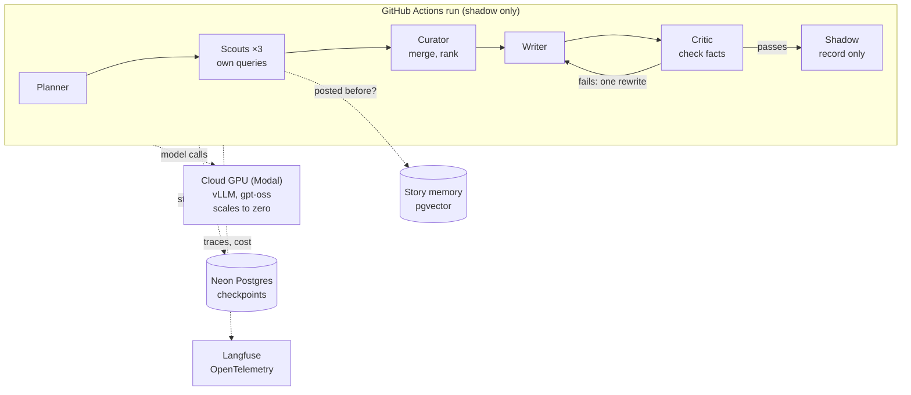

# Agentic Content Engine: Design

**An agentic, multi-agent version of a production AI content system, running self-hosted open-weight models on serverless cloud GPUs, and built to prove with measurements whether agents beat a fixed workflow per dollar.**

> **Status: design phase.** This repository holds the planning only: the [design](docs/design.md) is complete and under review. The implementation will live in a separate private repository once the open decisions are made. Nothing in the planned system publishes; it runs in shadow mode against the production workflow.

## Why this exists

A [production workflow](https://github.com/TechNaom/autonomous-ai-workflow-field-guide) already publishes a daily AI-news post to LinkedIn autonomously, on a $10/month budget. Running it daily exposed problems that need judgment rather than more rules: the same story under a reworded headline, roundup articles that hide several launches, and sources that disagree on a number. This project tests whether **agents** solve those better, and at what cost.

## Design at a glance

| | |
|---|---|
| **Agents** | Planner, three parallel Scouts, Curator, Writer, Critic, Shadow publisher; they share one typed state and never call each other |
| **Orchestration** | LangGraph, routing in code, model judgment inside agents; state checkpointed after every step so runs resume and replay |
| **Models** | `gpt-oss-20b` (about 16 GB VRAM) to prove the plumbing, then `gpt-oss-120b` on an A100 80 GB, served by vLLM |
| **GPU hosting** | Serverless, per-second billing, scale to zero: an estimated $4–$12.50 a month for one run a day (to be measured in phase 1) |
| **Memory** | pgvector story memory with CPU embeddings, so old news is dropped at the source |
| **Multi-cloud track** | The same agents deployed on Google Cloud (Cloud Run + L4 GPU), Azure (Container Apps + serverless GPU) and AWS (Bedrock AgentCore), with Terraform, measured side by side |
| **Success test** | One week side by side with the production workflow: repeats caught, launches missed, unsupported claims, latency and cost per run |

## Read more

- [Full design](docs/design.md): goals, agents, state, GPU options with sourced prices, cost model, failure handling, evaluation, phases and decisions.
- [Motivation agent](docs/motivation-agent.md): the first use case. LangGraph agents write grounded motivation and build-journey posts at 10 AM IST, with pgvector memory.
- [Field guide to the production workflow](https://github.com/TechNaom/autonomous-ai-workflow-field-guide): the system this one is compared against.

---

*Author: [TechNaom](https://github.com/TechNaom). Prices and figures are sourced and dated; estimates are labelled as estimates.*
