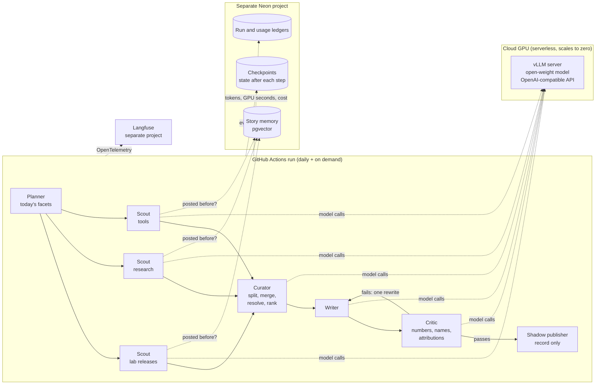
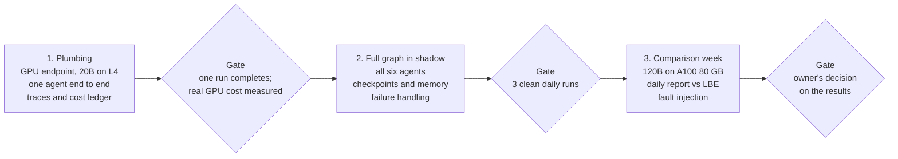

# agentic-content-engine: design

**Status:** draft for the owner's review, 2026-10-13. Nothing is built until the owner approves this document.
**Owner:** TechNaom. **Reference system:** `linkedin-branding-engine` (LBE), which stays untouched.

## 1. Goal

Build an **agentic** version of the daily AI-news post, running **self-hosted open-weight models on cloud GPUs**, and find out with measurements whether agents beat LBE's fixed workflow **per dollar**.

**Success criteria (all measured in shadow mode against LBE on the same days' news):**

| Measure | LBE baseline | Agentic version must |
|---|---|---|
| Stories already posted on an earlier day that reappear | Title similarity at 75% | Catch more, without dropping real follow-ups |
| Major frontier-lab launches missed | Measured per day | Miss fewer |
| Unsupported claims reaching the draft | Replayed through the critic | Be lower |
| Cost per run | About $0.004 (light mode) | Be reported honestly; the GPU cost is the price of the experiment |
| Run reliability | Daily since 2026-10-11 | Complete within 20 minutes, every day, for a week |

**It never publishes during this phase.** Going live is a separate decision after a week of results.

## 2. Architecture



**Key choices:**

| Decision | Choice | Reason |
|---|---|---|
| Orchestration | LangGraph `StateGraph` with routing in code; model judgment inside agents (hybrid) | Code guarantees order and hard rules; agents add judgment where it pays |
| Communication | Agents never call each other; they read and write one typed state | Every hand-off is logged, checkpointed and replayable |
| Persistence | Postgres checkpointer after every step, `thread_id` = run date | A crashed run resumes; any run can be replayed step by step |
| Model access | One OpenAI-compatible endpoint served by vLLM | The agents don't care where the model runs; switching provider is a URL change |
| Memory | pgvector story memory; embeddings from fastembed (`BAAI/bge-small-en-v1.5`, 384 dimensions) on CPU | Free and fast; no GPU needed for embeddings |
| Observability | OpenTelemetry to Langfuse, same conventions as LBE | Directly comparable traces and dashboards |

## 3. Agents

| Agent | Reads from state | Writes to state | Model use |
|---|---|---|---|
| Planner | Date, recent coverage from memory | `plan`: the facets to search today | Small decision |
| Scout (×3, in parallel) | Its facet | `items[]`: story, claim, URL, date, outlet; follow-up tag | Chooses its own queries; searches again if results are thin (max 2 rounds) |
| Curator | `items[]` | `stories[]`: merged, conflicts resolved, ranked | Splits roundups; decides "same event?" for borderline pairs; applies source precedence |
| Writer | `stories[]` | `draft` | Writes the post in the owner's voice |
| Critic | `draft`, `stories[]` | `verdict` with reasons | Checks numbers, names and attributions only |
| Shadow publisher | `draft`, `verdict` | `payload` (recorded, never sent) | None |

**Hard rules enforced in code, not prompts:** the curator always runs before the writer; the writer reads only curator stories; at most one rewrite; nothing proceeds without the critic passing; no agent holds a LinkedIn token.

## 4. Shared state (sketch)

```python
class RunState(TypedDict):
    plan: list[str]
    items: Annotated[list[Item], operator.add]          # parallel scouts append
    stories: list[Story]
    draft: str | None
    verdict: Verdict | None
    rewrites: int
    agent_runs: Annotated[list[AgentRun], operator.add] # status, attempts, latency, tokens, GPU seconds
    payload: dict | None
```

## 5. Model serving on cloud GPU

### Models

| Model | Memory needed | Fits on | Source |
|---|---|---|---|
| `openai/gpt-oss-20b` | Runs on 16 GB+ cards with its default quantized weights | L4 (24 GB), A10, L40S, A100 | [vLLM recipe](https://recipes.vllm.ai/openai/gpt-oss-20b) |
| `openai/gpt-oss-120b` | Fits on a single A100 80 GB; on H100 the recipe notes out-of-memory at default settings and gives a workaround | A100 80 GB, H100 | [vLLM GPT-OSS recipe](https://docs.vllm.ai/projects/recipes/en/latest/OpenAI/GPT-OSS.html) |

LBE writes with `gpt-oss-120b` today (hosted on Groq), so the same family keeps the comparison fair: any difference comes from the agentic design, not the model.

### Where to run it

| Option | Billing | Prices (opened 2026-10-13) | Fit |
|---|---|---|---|
| **Modal serverless** (recommended) | Per second, scales to zero | L4 $0.000222/s, A10 $0.000306/s, L40S $0.000542/s, A100 80 GB $0.000694/s, H100 $0.001097/s; Starter plan includes $30/month of credits ([Modal pricing](https://modal.com/pricing)) | Pay only while a run is active; deployable from GitHub Actions |
| RunPod serverless | Per hour shown, billed by the second | L4/24 GB $0.69/h, L40S $1.75/h, A100 80 GB $2.72/h, H100 $4.79/h ([RunPod pricing](https://www.runpod.io/pricing-page)) | Similar model; no free monthly credit found |
| RunPod pod (always on) | Per hour while running | L4 $0.59/h, A100 80 GB $1.79/h, H100 SXM $3.99/h ([RunPod pricing](https://www.runpod.io/pricing-page)) | About $1,300/month for an A100 left on (730 h × $1.79): wrong shape for one run a day |

### Cost estimate (to be replaced by measurements)

A run's GPU time is the model load (cold start) plus inference. Both are **assumptions until the first run measures them**:

| Setup | Assumed GPU time per run | Cost per run | Per month (1 run a day) |
|---|---|---|---|
| gpt-oss-20b on L4 (Modal) | 10 minutes | 600 s × $0.000222 = **$0.13** | **~$4**, inside the $30 free credit |
| gpt-oss-120b on A100 80 GB (Modal) | 10 minutes | 600 s × $0.000694 = **$0.42** | **~$12.50**, inside the $30 free credit |
| gpt-oss-120b on H100 (Modal) | 10 minutes | 600 s × $0.001097 = **$0.66** | **~$20** |

Plus CPU and memory on the GPU container (Modal bills these per second as well), and practice runs on top of the daily one.

**Budget guard (same pattern as LBE):** a hard monthly cap on GPU spend, checked before each run starts; the GPU app scales to zero and has a maximum runtime per run; the cost of every run is recorded in the ledger.

**Budget (decided 2026-10-13): $10/month hard cap, under ₹1,000.** gpt-oss-20b on L4 is the default (~$4/month for a daily run); gpt-oss-120b runs only during the comparison week (~$3 for 7 runs). Total ~$7 before Modal's $30 monthly credit. An always-on GPU (about $1,300/month for an A100) is ruled out.

## 6. Failure handling

| Failure | Response |
|---|---|
| GPU cold start slow or capacity unavailable | Retry with backoff; then fall back to another GPU type; after that, skip the day and alert |
| Model returns malformed output | Schema validation; re-ask once; then fail that agent |
| A scout fails | Continue with the others; record the coverage gap in state |
| Critic rejects twice | Skip the day (shadow, so nothing is lost), with the reasons recorded |
| Budget cap reached | Refuse to start, fail closed, alert |
| Run killed mid-way | Resume from the last checkpoint |

Per-agent retries and timeouts use LangGraph's `RetryPolicy` and per-node timeouts.

## 7. Evaluation

- **Reuse LBE's seeded fact-check eval for the critic.** It has 25 cases, real recorded judge answers, and offline re-scoring of saved runs at no cost.
- **Daily side-by-side report:** for each day, LBE's post vs the agentic draft, with repeats caught, launches covered, unsupported claims, steps, latency, GPU seconds and cost.
- **Fault injection:** kill a scout, time out search, stall the GPU, to show the system degrades and resumes as designed.
- **Decision after one week:** go further only if the agentic version is measurably better per dollar.

## 8. Deployment and security

- **Serverless only:** GitHub Actions runs the graph; Modal hosts the model; Neon and Langfuse are managed. Deployed from Actions (`modal deploy`), no local installs.
- **Separate everything from LBE:** its own Neon project, Langfuse project, Modal workspace, search API quota and secrets, so the experiment can never starve or break the daily post.
- **No LinkedIn credentials at all** in this repo during the shadow phase.
- CI on every PR: lint, type checks, tests, secret scan. Practice runs on any branch.

## 9. Phases and gates

Nothing moves to the next phase until its gate is met.



Phase 1 replaces the cost estimates with measured GPU seconds, so the budget is known before the full graph runs daily.

## 10. Decisions

| Decision | Options | Recommended | Status |
|---|---|---|---|
| Owner, repo, model hosting | — | TechNaom, `agentic-content-engine`, self-hosted open-weight models on cloud GPU | Decided 2026-10-13 |
| Monthly GPU budget cap | — | **$10/month hard cap** (under ₹1,000), the owner's R&D budget: gpt-oss-20b on L4 daily (~$4) plus one comparison week on gpt-oss-120b (~$3); Modal's $30 monthly credit may cover all of it | Decided 2026-10-13 |
| Critic model family | Same as the writer, or a different open-weight family | Different family: judges tend to favour their own family's text, which is why LBE's judge is a different family | Open |
| GPU provider | Modal or RunPod | Modal: per-second billing, scale to zero, $30 monthly credit | Open |
| Search provider for scouts | Tavily on a separate key, or another provider | Tavily on a separate key: proven in LBE; a separate quota protects the daily post | Open |

## References

- [Modal pricing](https://modal.com/pricing), opened 2026-10-13
- [RunPod pricing](https://www.runpod.io/pricing-page), opened 2026-10-13
- [vLLM recipe: gpt-oss-20b](https://recipes.vllm.ai/openai/gpt-oss-20b) and [vLLM GPT-OSS recipe](https://docs.vllm.ai/projects/recipes/en/latest/OpenAI/GPT-OSS.html)
- [Building effective agents](https://www.anthropic.com/engineering/building-effective-agents), Anthropic: workflows vs agents
- LBE design and lessons: the public field guide, `TechNaom/autonomous-ai-workflow-field-guide`
