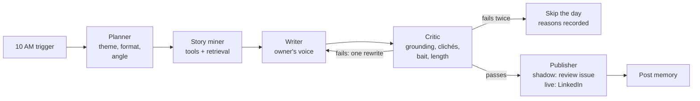

# Motivation agent: design

**Status:** draft for the owner's review, 2026-10-15.
**First use case of `agentic-content-engine`.** The daily AI-news post (`linkedin-branding-engine`) stays exactly as it is.

## 1. Goal

A second LinkedIn post, written by agents: motivation, build-journey stories and lessons
**grounded in the owner's real work** (repos, issues, POCs, courses). The news post is a fixed
workflow because its job is accuracy at low cost; this post's job is **variety and authenticity**,
which is where agent judgment and tools pay off.

| | AI-news post (LBE) | Motivation post (this agent) |
|---|---|---|
| Time | Daily, 4 PM IST | **10 AM IST** (04:30 UTC), **Mon / Wed / Fri** to start |
| Shape | Same every day | Theme and format chosen per day |
| Engine | Fixed workflow | LangGraph agents with tools and memory |
| Repo, accounts | Existing | Separate repo, separate accounts and quotas |

**Success criteria for the shadow phase (two weeks, 6 drafts):**

- Zero personal claims that can't be traced to a source (hard rule).
- No theme or story repeated within 21 days.
- The owner would post at least 4 of 6 drafts with no more than light edits.
- Every run completes within 15 minutes; cost per run recorded.

## 2. Graph



| Node | Reads | Writes | Model use |
|---|---|---|---|
| Planner | Date, post memory (last 21 days) | `plan`: theme, format (story / lesson / list / question), angle | Small decision |
| Story miner | `plan` | `evidence[]`: facts with their source (repo, commit, issue, doc chunk, URL) | Chooses tools and queries; max 2 rounds |
| Writer | `plan`, `evidence[]`, 2-3 voice examples | `draft` | Writes in the owner's voice |
| Critic | `draft`, `evidence[]` | `verdict` with reasons | Checks every claim against evidence |
| Publisher | `draft`, `verdict` | `payload`, post memory | None |

**Hard rules in code, not prompts:** the writer sees only `evidence[]` gathered this run; at most
one rewrite; nothing publishes without the critic passing; the post-memory write happens only
after publishing; one post per scheduled day (own idempotency key, independent of the news post).

**Shared state (sketch):**

```python
class MotivationState(TypedDict):
    plan: Plan | None
    evidence: Annotated[list[Evidence], operator.add]  # each fact carries its source
    draft: str | None
    verdict: Verdict | None
    rewrites: int
    agent_runs: Annotated[list[AgentRun], operator.add]  # latency, tokens, GPU seconds
    payload: dict | None
```

LangGraph provides the `StateGraph`, conditional routing, a Postgres checkpointer
(`thread_id` = run date, so a crashed run resumes) and per-node `RetryPolicy`.
LangChain provides the tool wrappers, structured output and the model interface.

## 3. Two orchestrators

The same nodes and tools run under two orchestrators, chosen by one setting (`ORCHESTRATOR=code|prompt`),
so they can be compared on the same days.

| Orchestrator | How it works | Role |
|---|---|---|
| **Code-based** (default) | LangGraph `StateGraph`; routing in code (conditional edges) | Production: predictable, cheap, testable |
| **Prompt-based** | A supervisor model sees the nodes as tools and decides the next step itself | R&D: flexibility, measured against the code graph |

In both, the hard rules stay in code: the critic must pass before publishing, at most one rewrite,
budget and search caps. Inside both, the **story miner is a ReAct agent** (it picks its own tools in a
loop, max 2 rounds) and **critic → writer is a reflection loop**. So the project covers the four common
patterns: fixed workflow, supervisor, ReAct and reflection.

**Comparison** (same 6 shadow days): drafts the owner would post, grounding failures caught, cost,
latency, run success rate.

## 4. Tools and MCP

| Tool | Source | What it returns | Limits |
|---|---|---|---|
| GitHub activity | **GitHub's official MCP server** (consumed) | Owner's recent commits, PRs, issues, repos | Read-only token; last 30 days |
| `search_knowledge` | **Our knowledge MCP server** (provided) | Top-k chunks of the owner's material (section 5) | k ≤ 8 per call |
| `get_evidence` | Our knowledge MCP server | Owner-attested facts from the evidence register (`evidence/register.json`, LBE's format) | Read-only; only the owner adds entries |
| `recent_posts` | Our knowledge MCP server | Past motivation posts with theme and date | Last 21 days |
| `web_search` (Tavily) | LangChain tool | A quote or reference, always with its URL | **Hard cap: 5 searches per run** |

**MCP in both directions:**

- **Consume:** GitHub's MCP server gives the miner its GitHub tools, loaded into LangGraph with
  `langchain-mcp-adapters`.
- **Provide:** our own knowledge MCP server (Python MCP SDK, FastMCP). The agent reaches its knowledge
  through it, and the owner can add the same server to Claude Code or Claude Desktop to query the
  owner's own work.
- **Transport:** stdio. In the GitHub Action each server runs as a subprocess of the run: no hosting,
  no cost. Streamable HTTP only if a hosted endpoint is ever needed.
- Tool output is untrusted: it passes through LBE's `untrusted.py` escaping before entering a prompt.

## 5. Knowledge and memory (vector database)

| Collection | Contents | Used by |
|---|---|---|
| `knowledge` | Chunks of the owner's repo READMEs, design docs, field guide, user stories, issue threads | Story miner (grounding), critic (verification) |
| `posts` | Every published motivation post, with theme and date | Planner (no repeats), writer (voice examples) |

- **Main store: pgvector on Neon** (one Postgres for checkpoints, ledgers and vectors; similarity
  and filters such as date in one SQL query; keyword search via Postgres full-text for hybrid retrieval).
- **R&D comparison: Qdrant Cloud** (free tier), behind LangChain's `VectorStore` interface so the
  switch is one setting. Measured on the same queries: recall@k against hand-labelled questions, latency.
- **Embeddings:** fastembed `BAAI/bge-small-en-v1.5` (384 dimensions) on CPU in the Action: free, no GPU.
- **Refresh:** a weekly Action re-indexes changed files (content hash per chunk); deleted files drop their chunks.

## 6. Grounding and the critic

The main risk is an invented personal story ("I failed ten times before..."). Rules:

1. **Every first-person claim must cite evidence:** a tool result in `evidence[]`, or an owner-attested
   entry in the evidence register cited as `[ev:<id>]`. The critic reuses LBE's integrity checks
   (D7-D9 in `gate/integrity.py`) and fails the draft on any claim without one.
2. **Clichés:** a banned-phrase list plus a model check ("could anyone have written this?").
3. **No engagement bait** ("comment YES", "repost if"), as in LBE's voice guide.
4. **Length** within LinkedIn's limit, with the GitHub and follow lines in the sign-off.

## 7. Models

| Role | Model | Where |
|---|---|---|
| Planner, story miner, writer | `gpt-oss-20b` | vLLM on Modal L4, scales to zero |
| Critic | A different open-weight family (to avoid self-preference) | Open decision; candidate: Gemma 4, if it fits the GPU budget |

All calls go to one OpenAI-compatible URL per role, so a provider change is a setting.

## 8. Review, publishing and schedule

- **Trigger:** an exact-time cron (the same Cloudflare Worker pattern LBE uses; GitHub's own cron ran
  hours late) dispatches the workflow at 04:30 UTC on Mon, Wed, Fri.
- **Shadow phase:** each draft is opened as an issue in the private repo, so GitHub emails it to the
  owner; nothing is sent to LinkedIn.
- **Live phase:** the LinkedIn Posts API with its own idempotency key and kill switch.

## 9. Accounts, secrets and cost

Service accounts (Modal, Neon, Qdrant, Langfuse, Tavily) are the agent's own; the code reads every
endpoint and key from GitHub Secrets and does not depend on which account they belong to.

| Item | Estimate (to be replaced by measurements) |
|---|---|
| Modal L4 GPU, about 10 min per run, 13 runs a month | 13 × 600 s × $0.000222 ≈ **$1.75/month** |
| Neon, Qdrant, Langfuse, GitHub Actions | Free tiers |
| Tavily | ≤ 5 searches per run, ≤ 65 a month |

Hard caps in code: monthly GPU spend ($10, shared with the rest of the agent R&D), searches per run,
max run time. The run refuses to start when a cap is reached.

## 10. Reuse from LBE

LBE's plumbing is proven in production, so it is **copied** into the new repo (each file notes its
source: LBE at tag `stable-2026-10-15`). It is not imported as a library: a change made for the agent
must never be able to break the live 4 PM post.

| Reused | LBE source |
|---|---|
| Settings and preflight | `settings.py`, `setup_env.py`, `preflight.py` |
| Tracing to Langfuse | `tracing_otel.py`, `tracing_langfuse.py`, `spans.py`, `observe.py` |
| Budget caps and cost ledger | `usage/`, `writer/pricing.py` |
| Publishing (idempotency, kill switch, shadow digest) | `publisher/`, `linkedin_auth.py` |
| Evidence register and integrity checks (critic core) | `evidence/register.py`, `gate/integrity.py`, `untrusted.py` |
| The owner's voice guide | `writer/voice_guide.py` |
| Alerts, watchdog, run history | `alerts/`, `watchdog.py`, `run_history.py`, `health.py` |
| Exact-time trigger | `ops/trigger/cloudflare/` (cron 04:30 UTC Mon/Wed/Fri) |
| CI, shadow test, watchdog workflows | `.github/workflows/` |

**New:** the LangGraph graph and nodes, LangChain tools, the vector store and indexer, the shadow
review issue, the Modal model deployment. **Not needed:** `news/` and the judge-specific parts of `gate/`.

## 11. Interview coverage

The project is built to cover the topics asked in agent and GenAI interviews. The code repo keeps
`docs/interview-guide.md`: for each topic, the decision, the trade-off and the **measured** result.

| Topic | Where it lives |
|---|---|
| Workflows vs agents, orchestration patterns | Code graph vs supervisor, ReAct miner, reflection loop |
| State, checkpointing, resume, replay | Typed state, Postgres checkpointer, `thread_id` = run date |
| Tools and function calling | Typed tool schemas; tool errors returned to the model |
| MCP: client, server, transports | Section 4 |
| RAG | Chunking, embeddings, hybrid search, metadata filters, re-index by content hash |
| Vector DB choice | pgvector vs Qdrant on the same labelled queries (recall@k, latency) |
| Short- vs long-term memory | Graph state vs knowledge and post collections |
| Guardrails, hallucination control | Evidence register, integrity checks, untrusted-text escaping, structured output |
| Human in the loop | Shadow review issue; LangGraph `interrupt` before publishing in the live phase |
| Evals | Retrieval recall@k, critic seeded faults, orchestrator A/B, LLM-as-judge from another family |
| Observability | OpenTelemetry to Langfuse: per-node latency, tokens, GPU seconds, cost |
| Cost and reliability | Hard caps, retries and timeouts, idempotency, kill switch, fallbacks |
| Self-hosting and deployment | gpt-oss-20b on vLLM (Modal L4), GitHub Actions, Docker |
| Security | Secrets in GitHub Secrets, least-privilege tokens, prompt-injection handling |

## 12. Phases and gates

Each phase ends with a review by the owner before the next starts.

| Phase | Deliverable | Needs from the owner |
|---|---|---|
| 1. Skeleton | Private repo, copied LBE plumbing, CI; the code graph runs end to end on a scripted model in tests | — |
| 2. Knowledge and MCP | Indexer + pgvector; our knowledge MCP server; GitHub MCP in the miner | Neon account, read-only GitHub token |
| 3. Real model | vLLM gpt-oss-20b on Modal (tool calling verified); first real shadow draft as a review issue; GPU cost measured | Modal, Langfuse accounts |
| 4. Second orchestrator | Prompt-based supervisor; eval harness comparing both; Qdrant comparison | Qdrant account |
| 5. Shadow fortnight and live | 6 drafts reviewed; `interrupt` + approve-to-publish; live Mon / Wed / Fri at 10 AM IST | Go-ahead to post |

## 13. Decisions

| Decision | Choice | Status |
|---|---|---|
| Where it lives | `agentic-content-engine` (private), first use case | Decided 2026-10-15 |
| Base | Copy LBE's proven plumbing (section 10); build only the agent parts | Owner, 2026-10-15 |
| Time | 10 AM IST | Decided 2026-10-15 |
| Days | Mon / Wed / Fri, then review | Default, owner may change |
| Style | Mix: motivation, build journey, lessons (planner rotates) | Default, owner may change |
| Vector DB | pgvector main, Qdrant comparison | Decided 2026-10-15 |
| Orchestration | Both: code-based graph (default) and prompt-based supervisor, compared | Decided 2026-10-15 |
| MCP | Consume GitHub's server; provide our own knowledge server; stdio | Decided 2026-10-15 |
| Owner facts | LBE's evidence register format (`[ev:<id>]` citations) | Decided 2026-10-15 |
| Critic family | Different open-weight family | Open |
