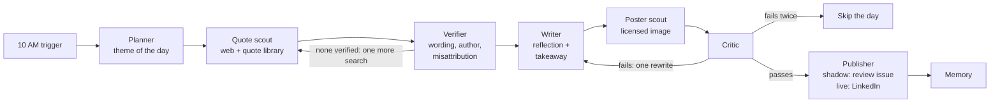

# Motivation agent: design

**Status:** v2 draft for the owner's review, 2026-10-24.
**First use case of `agentic-content-engine`.** The daily AI-news post (`linkedin-branding-engine`) stays exactly as it is.

**What changed in v2 (owner, 2026-10-24):** the posts are general motivation built from **real quotes
found on the web, with a poster image from the web**, not stories about the owner's repos or
achievements. The agents, tools and checks changed accordingly; the orchestration, state,
checkpointing, critic loop and reuse from LBE did not.

## 1. Goal

A second LinkedIn post at **10 AM IST** (04:30 UTC), **Mon / Wed / Fri** to start: a verified quote,
a short reflection with one practical takeaway, and a poster image.

| | AI-news post (LBE) | Motivation post (this agent) |
|---|---|---|
| Time | Daily, 4 PM IST | 10 AM IST, Mon / Wed / Fri |
| Content | 5–7 AI news items | One verified quote + reflection + poster |
| Engine | Fixed workflow | LangGraph agents with tools and memory |
| Repo, accounts | Existing | Separate repo, separate accounts and quotas |

**Success criteria for the shadow phase (two weeks, 6 drafts):**

- Every quote verified: wording and author confirmed by the sources in section 6; zero misattributed quotes.
- Every poster has a recorded licence that allows reuse, with its credit line when required.
- No quote or author repeated within 60 days; no theme within 21 days.
- The owner would post at least 4 of 6 drafts with no more than light edits.
- Every run completes within 15 minutes; cost per run recorded.

## 2. Graph

| Agent | Reads | Writes | Model use |
|---|---|---|---|
| Planner | Date, memory (recent themes, quotes, authors) | `plan`: theme, angle, search queries | Small decision |
| Quote scout | `plan` | `candidates[]`: quote text, claimed author, where found | Chooses tools and queries (ReAct, max 2 rounds) |
| Verifier | `candidates[]` | `quote`: the chosen verified quote with its evidence, or none | Judges whether sources confirm wording and author |
| Writer | `plan`, `quote` | `draft`: quote block, reflection, takeaway, hashtags | Writes in the owner's voice |
| Poster scout | `plan`, `quote` | `poster`: image URL, licence, credit line | Picks the best-matching licensed image |
| Critic | `draft`, `quote`, `poster` | `verdict` with reasons | Free checks first, then one model judgment |
| Publisher | `draft`, `poster`, `verdict` | `payload`, memory | None |

**Hard rules in code, not prompts:** no quote reaches the writer unless the verifier recorded its
evidence; the quote in the post must match the verified wording exactly; the poster's licence must
be on the allow-list; at most one extra quote search and one rewrite; nothing publishes without the
critic passing; one post per scheduled day (own idempotency key, independent of the news post).

## 3. Three versions, one study

Only three steps need a real agent (open-ended decisions in a loop): the **quote scout**, the
**verifier** and the **poster scout**. The planner, writer and critic are single model calls, and
the publisher is plain code. Rather than assume multi-agent is better, the project builds three
versions on the same tools, state and checks, and measures them on the same days.

| Version | Shape | Role |
|---|---|---|
| **A. Fixed workflow** | LBE-style: code steps with single model calls, no tool loops | Baseline |
| **B. Multi-agent hybrid** (default) | Code-routed `StateGraph`; the three agents run ReAct loops inside their steps | Production default |
| **C. Supervisor** | A supervisor model decides which agent runs next | Flexibility, measured |

Hard rules stay in code in all three. Verifier → scout and critic → writer are **reflection loops**.
Chosen by one setting (`ORCHESTRATOR=workflow|graph|supervisor`).

**Measured on the same days:** verified-quote rate, misattributions caught, the owner's rating of
each draft, cost, latency, run success rate.

## 4. Tools and MCP

| Tool | Source | Returns | Limits |
|---|---|---|---|
| Web search | **Tavily's MCP server** (consumed) | Pages with candidate quotes | Hard cap: 5 searches per run |
| `wikiquote_lookup` | Wikiquote (MediaWiki API, free, no key) | The author's page: sourced quotes, and the "Disputed" and "Misattributed" sections | Cached per author |
| `search_quote_library` | **Our quotes MCP server** (provided) | Verified quotes from earlier runs, by meaning (vector search) | k ≤ 8 |
| `recent_posts` | Our quotes MCP server | Quotes, authors and themes used recently | Last 60 days |
| `find_poster` | Wikimedia Commons, Unsplash, Pexels APIs | Images with licence and credit metadata | Allow-listed licences only |

**MCP in both directions:** consume Tavily's MCP server for web search; provide our own **quotes MCP
server** (Python MCP SDK, FastMCP) over the verified quote library and post memory, which the agents
use and the owner can also add to Claude Code or Claude Desktop. Transport: **stdio** inside the
GitHub Action (no hosting, no cost). Tool output is untrusted and passes through LBE's
`untrusted.py` escaping before it enters a prompt.

## 5. Knowledge and memory (vector database)

| Collection | Contents | Used by |
|---|---|---|
| `quotes` | Every verified quote: text, author, sources, verification result, themes | Quote scout (find by meaning), verifier (skip re-verifying), planner |
| `posts` | Every published post: quote, author, theme, poster, date | Planner and critic (no repeats), writer (voice examples) |

- **Main store: pgvector on Neon** (one Postgres for checkpoints, ledgers and vectors; similarity and
  filters such as date in one SQL query; hybrid search with Postgres full-text).
- **R&D comparison: Qdrant Cloud** (free tier), behind LangChain's `VectorStore` interface; measured on
  the same queries (recall@k, latency).
- **Embeddings:** fastembed `BAAI/bge-small-en-v1.5` (384 dimensions) on CPU in the Action: free.

## 6. Verification and the critic

The main risks are a **misattributed quote** ("Einstein said…" when he did not) and an **invented
detail** in the reflection.

**Verifier rules:**
1. A quote is verified only if its wording appears on the author's Wikiquote page outside the
   "Disputed" and "Misattributed" sections, **or** in at least two independent reputable sources found
   by search. The matching source excerpts are stored as evidence.
2. A quote listed as disputed or misattributed anywhere is rejected.
3. If no candidate is verified, the scout searches once more; then the day is skipped.

**Critic checks (free checks first, then one model call):**
1. The quote and author in the draft match the verified record exactly.
2. No first-person experience claims at all (LBE's integrity check with an empty register:
   opinions such as "I think" are allowed, "I built…" is not); every number comes from a source.
3. The poster's licence is allow-listed, and its credit line is in the post when the licence requires one.
4. Length, no markdown, emoji limit, banned clichés and engagement bait.
5. Model judgment: is the reflection specific and useful, or generic filler?

## 7. Models

| Role | Model | Where |
|---|---|---|
| Planner, scouts, verifier, writer | `openai/gpt-oss-120b` | **Groq** (as in LBE; separate key and hard cap) |
| Critic | A different open-weight family (to avoid self-preference) | Open decision; candidate: Gemma 4 |

All calls go to one OpenAI-compatible URL per role, so a provider change is a setting. Starting on
Groq follows LBE; self-hosting `gpt-oss-20b` on vLLM (Modal L4) is a later experiment on the same setting.

## 8. Review, publishing and schedule

- **Trigger:** an exact-time cron (the Cloudflare Worker pattern LBE uses) dispatches the workflow at
  04:30 UTC on Mon, Wed, Fri.
- **Shadow phase:** each draft and its poster are opened as an issue in the private repo, so GitHub
  emails them to the owner; nothing is sent to LinkedIn.
- **Live phase:** LinkedIn's Images API uploads the poster, then the Posts API publishes, with its own
  idempotency key and kill switch.

## 9. Accounts, secrets and cost

Service accounts (Modal, Neon, Qdrant, Langfuse, Tavily, Unsplash/Pexels) are the agent's own; the code
reads every endpoint and key from GitHub Secrets and does not depend on which account they belong to.

| Item | Estimate (to be replaced by measurements) |
|---|---|
| Groq `gpt-oss-120b`, about 10 calls per run, 13 runs a month | Cents per month (measured in the ledger from the first run) |
| Neon, Qdrant, Langfuse, GitHub Actions, Wikiquote, Wikimedia, Unsplash, Pexels | Free tiers |
| Tavily | ≤ 5 searches per run, ≤ 65 a month |

Hard caps in code: monthly GPU spend ($10, shared with the rest of the agent R&D), searches per run,
max run time. The run refuses to start when a cap is reached.

## 10. Reuse from LBE

LBE's plumbing is proven in production, so it is **copied** into the new repo (each file notes its
source: LBE at tag `stable-2026-10-15`), never imported, so a change made for the agent can never
break the live 4 PM post.

| Reused | LBE source |
|---|---|
| Integrity checks (no invented first-person claims, numbers from sources) | `gate/integrity.py`, `gate/text.py`, `evidence/register.py` |
| Untrusted-text escaping | `untrusted.py` |
| Voice rules (brand line, no hype, no bait, limits) | `writer/voice_guide.py` |
| Settings, tracing to Langfuse, budget caps and ledger | `settings.py`, `tracing_*.py`, `usage/`, `writer/pricing.py` |
| Publishing (idempotency, kill switch, shadow digest) | `publisher/`, `linkedin_auth.py` |
| Alerts, watchdog, run history, exact-time trigger, CI | `alerts/`, `watchdog.py`, `run_history.py`, `ops/trigger/cloudflare/`, `.github/workflows/` |

## 11. Interview coverage

The code repo keeps `docs/interview-guide.md`: for each topic, the decision, the trade-off and the
**measured** result.

| Topic | Where it lives |
|---|---|
| Workflows vs agents, orchestration patterns | Versions A, B, C measured on the same days; ReAct scouts; two reflection loops |
| Multi-agent design | Seven agents with one responsibility each, communicating only through state |
| State, checkpointing, resume, replay | Typed state, Postgres checkpointer, `thread_id` = run date |
| Tools and function calling | Typed tool schemas; tool errors returned to the model |
| MCP: client, server, transports | Section 4 |
| RAG and vector DB choice | Quote library, hybrid search, pgvector vs Qdrant |
| Fact-checking agents | The verifier: source agreement, misattribution lists, evidence records |
| Guardrails, hallucination control | Exact-match quote check, integrity checks, licence allow-list, untrusted-text escaping |
| Human in the loop | Shadow review issue; LangGraph `interrupt` before publishing in the live phase |
| Evals | Verifier precision on a labelled set of real vs misattributed quotes; orchestrator A/B; LLM-as-judge from another family |
| Observability | OpenTelemetry to Langfuse: per-agent latency, tokens, GPU seconds, cost |
| Cost and reliability | Hard caps, retries and timeouts, idempotency, kill switch |
| Model hosting and deployment | Groq API first, then self-hosted vLLM (Modal) on the same setting; GitHub Actions, Docker |
| Security | Secrets in GitHub Secrets, least-privilege tokens, prompt-injection handling |

## 12. Phases and gates

Each phase ends with a review by the owner before the next starts.

| Phase | Deliverable | Needs from the owner |
|---|---|---|
| 1. Skeleton | Code graph on a scripted model in tests | Done 2026-10-15 (v1 agents) |
| 1b. Re-shape | Version B with the v2 agents (quote scout, verifier, poster scout) on fakes; tests for every hard rule | — |
| 2. Tools, MCP, memory | Tavily MCP, Wikiquote, poster APIs; quotes MCP server; pgvector library; Postgres checkpointer | Neon, Tavily, Unsplash/Pexels accounts |
| 3. Real model | Groq gpt-oss-120b; first real shadow draft with poster as a review issue; cost measured; Langfuse traces | Groq key, Langfuse account |
| 4. The study | Versions A (workflow) and C (supervisor) next to B; eval harness (verifier precision, A/B/C comparison); Qdrant comparison | Qdrant account |
| 5. Shadow fortnight and live | 6 drafts reviewed; `interrupt` + approve-to-publish; live Mon / Wed / Fri at 10 AM IST | Go-ahead to post |

## 13. Decisions

| Decision | Choice | Status |
|---|---|---|
| Where it lives | `agentic-content-engine` (private), first use case | Decided 2026-10-15 |
| Content | General motivation from verified web quotes, not the owner's work | Decided 2026-10-24 |
| Image | Posters from the web, licensed for reuse (Wikimedia Commons, Unsplash, Pexels), credited when required | Decided 2026-10-24 |
| Post text | Quote + short reflection + one takeaway + hashtags | Decided 2026-10-24 |
| Time and days | 10 AM IST, Mon / Wed / Fri, then review | Decided 2026-10-15 |
| Orchestration | Three versions: A workflow, B multi-agent hybrid (default), C supervisor, measured | Decided 2026-10-24 |
| Model | Groq `gpt-oss-120b` first (as LBE); self-hosted on Modal later | Decided 2026-10-24 |
| MCP | Consume Tavily's server; provide our own quotes server; stdio | Decided 2026-10-24 |
| Vector DB | pgvector main, Qdrant comparison | Decided 2026-10-15 |
| Critic family | Different open-weight family | Open |
