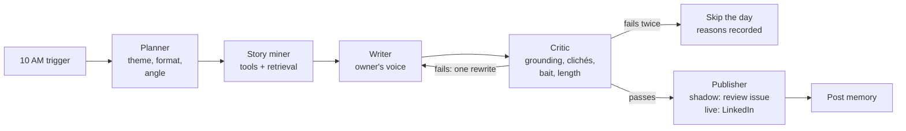

# Motivation agent: design

**Status:** draft for the owner's review, 2026-10-15.
**First use case of `agentic-content-engine`.** The daily AI-news post (`linkedin-branding-engine`) stays exactly as it is.

## 1. Goal

A second LinkedIn post, written by agents: motivation, build-journey stories and lessons
**grounded in the owner's real work** (repos, issues, POCs, courses). The news post is a fixed
workflow because its job is accuracy at low cost; this post's job is **variety and authenticity**,
which is where agent judgment and tools pay off.

| | AI-news post (LBE) | Motivation post (this agent) |
|---|---|---|
| Time | Daily, 4 PM IST | **10 AM IST** (04:30 UTC), **Mon / Wed / Fri** to start |
| Shape | Same every day | Theme and format chosen per day |
| Engine | Fixed workflow | LangGraph agents with tools and memory |
| Repo, accounts | Existing | Separate repo, separate accounts and quotas |

**Success criteria for the shadow phase (two weeks, 6 drafts):**

- Zero personal claims that can't be traced to a source (hard rule).
- No theme or story repeated within 21 days.
- The owner would post at least 4 of 6 drafts with no more than light edits.
- Every run completes within 15 minutes; cost per run recorded.

## 2. Graph



| Node | Reads | Writes | Model use |
|---|---|---|---|
| Planner | Date, post memory (last 21 days) | `plan`: theme, format (story / lesson / list / question), angle | Small decision |
| Story miner | `plan` | `evidence[]`: facts with their source (repo, commit, issue, doc chunk, URL) | Chooses tools and queries; max 2 rounds |
| Writer | `plan`, `evidence[]`, 2-3 voice examples | `draft` | Writes in the owner's voice |
| Critic | `draft`, `evidence[]` | `verdict` with reasons | Checks every claim against evidence |
| Publisher | `draft`, `verdict` | `payload`, post memory | None |

**Hard rules in code, not prompts:** the writer sees only `evidence[]` gathered this run; at most
one rewrite; nothing publishes without the critic passing; the post-memory write happens only
after publishing; one post per scheduled day (own idempotency key, independent of the news post).

**Shared state (sketch):**

```python
class MotivationState(TypedDict):
    plan: Plan | None
    evidence: Annotated[list[Evidence], operator.add]  # each fact carries its source
    draft: str | None
    verdict: Verdict | None
    rewrites: int
    agent_runs: Annotated[list[AgentRun], operator.add]  # latency, tokens, GPU seconds
    payload: dict | None
```

LangGraph provides the `StateGraph`, conditional routing, a Postgres checkpointer
(`thread_id` = run date, so a crashed run resumes) and per-node `RetryPolicy`.
LangChain provides the tool wrappers, structured output and the model interface.

## 3. Tools

| Tool | What it returns | Limits |
|---|---|---|
| `github_activity` | Owner's recent public commits, PRs, issues, new repos (GitHub API) | Last 30 days; public data only |
| `search_knowledge` | Top-k chunks from the owner's indexed material (section 4) | k ≤ 8 per call |
| `owner_facts` | Owner-approved facts file: roles, milestones, courses, numbers the owner is happy to share | Read-only; edited only by the owner |
| `web_search` (Tavily) | A quote or reference, always with its URL | **Hard cap: 5 searches per run** |

## 4. Knowledge and memory (vector database)

| Collection | Contents | Used by |
|---|---|---|
| `knowledge` | Chunks of the owner's repo READMEs, design docs, field guide, user stories, issue threads | Story miner (grounding), critic (verification) |
| `posts` | Every published motivation post, with theme and date | Planner (no repeats), writer (voice examples) |

- **Main store: pgvector on Neon** (one Postgres for checkpoints, ledgers and vectors; similarity
  and filters such as date in one SQL query; keyword search via Postgres full-text for hybrid retrieval).
- **R&D comparison: Qdrant Cloud** (free tier), behind LangChain's `VectorStore` interface so the
  switch is one setting. Measured on the same queries: recall@k against hand-labelled questions, latency.
- **Embeddings:** fastembed `BAAI/bge-small-en-v1.5` (384 dimensions) on CPU in the Action: free, no GPU.
- **Refresh:** a weekly Action re-indexes changed files (content hash per chunk); deleted files drop their chunks.

## 5. Grounding and the critic

The main risk is an invented personal story ("I failed ten times before..."). Rules:

1. **Every first-person claim must cite `evidence[]`** (a tool result or the facts file). The critic
   fails the draft on any claim without one, the same principle as LBE's evidence register.
2. **Clichés:** a banned-phrase list plus a model check ("could anyone have written this?").
3. **No engagement bait** ("comment YES", "repost if"), as in LBE's voice guide.
4. **Length** within LinkedIn's limit, with the GitHub and follow lines in the sign-off.

## 6. Models

| Role | Model | Where |
|---|---|---|
| Planner, story miner, writer | `gpt-oss-20b` | vLLM on Modal L4, scales to zero |
| Critic | A different open-weight family (to avoid self-preference) | Open decision; candidate: Gemma 4, if it fits the GPU budget |

All calls go to one OpenAI-compatible URL per role, so a provider change is a setting.

## 7. Review, publishing and schedule

- **Trigger:** an exact-time cron (the same Cloudflare Worker pattern LBE uses; GitHub's own cron ran
  hours late) dispatches the workflow at 04:30 UTC on Mon, Wed, Fri.
- **Shadow phase:** each draft is opened as an issue in the private repo, so GitHub emails it to the
  owner; nothing is sent to LinkedIn.
- **Live phase:** the LinkedIn Posts API with its own idempotency key and kill switch.

## 8. Accounts, secrets and cost

Service accounts (Modal, Neon, Qdrant, Langfuse, Tavily) are the agent's own; the code reads every
endpoint and key from GitHub Secrets and does not depend on which account they belong to.

| Item | Estimate (to be replaced by measurements) |
|---|---|
| Modal L4 GPU, about 10 min per run, 13 runs a month | 13 × 600 s × $0.000222 ≈ **$1.75/month** |
| Neon, Qdrant, Langfuse, GitHub Actions | Free tiers |
| Tavily | ≤ 5 searches per run, ≤ 65 a month |

Hard caps in code: monthly GPU spend ($10, shared with the rest of the agent R&D), searches per run,
max run time. The run refuses to start when a cap is reached.

## 9. Phases and gates

| Phase | Done when |
|---|---|
| 1. Skeleton | Private repo, CI, graph runs end to end with a scripted model in tests |
| 2. Real models and knowledge | Modal endpoint up; pgvector indexed; one real shadow draft; GPU cost measured |
| 3. Shadow fortnight | 6 drafts reviewed by the owner; success criteria met |
| 4. Live | Owner's go-ahead; Mon / Wed / Fri at 10 AM IST |

## 10. Decisions

| Decision | Choice | Status |
|---|---|---|
| Where it lives | `agentic-content-engine` (private), first use case | Proposed |
| Time | 10 AM IST | Decided 2026-10-15 |
| Days | Mon / Wed / Fri, then review | Default, owner may change |
| Style | Mix: motivation, build journey, lessons (planner rotates) | Default, owner may change |
| Vector DB | pgvector main, Qdrant comparison | Decided 2026-10-15 |
| Critic family | Different open-weight family | Open |
